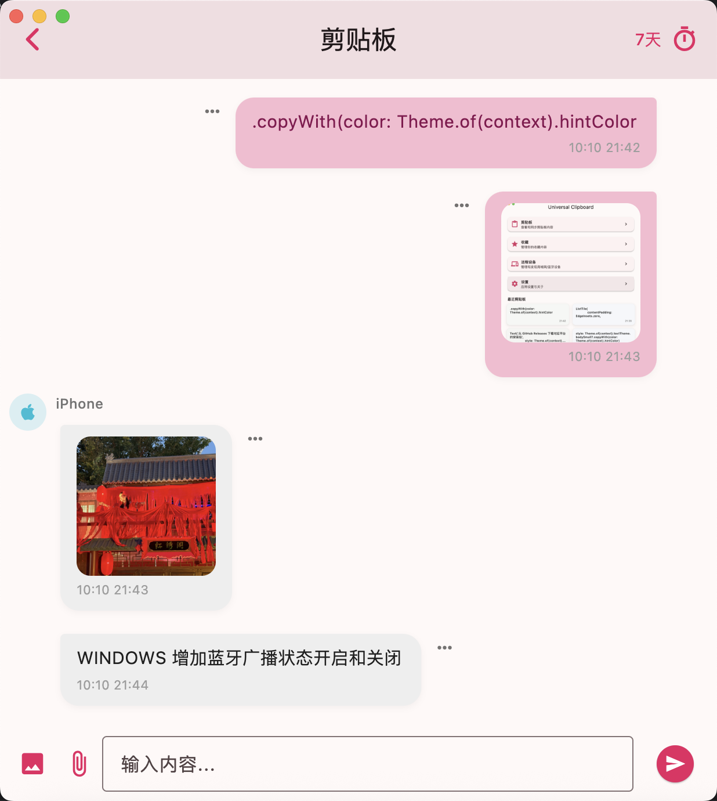
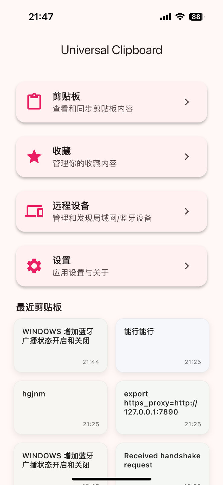

# Linkboard

A cross-device clipboard sync and history manager supporting LAN, Bluetooth, and WebRTC device-to-device transfer. It is local-first by default and does not require cloud storage for clipboard history; WebRTC connections may use Firebase signaling and STUN/TURN services.

[中文文档](README.md)

## Features
- Device-to-device transfer over LAN (TCP), Bluetooth (BLE), and WebRTC
- Uses TCP on the same LAN; falls back to other modes when direct connection is not possible
- Cross-platform: Android, iOS, Windows, macOS
- Sync text and images (auto-detect PNG/JPEG)
- History management with configurable retention days and one-tap cleanup
- App keyboard extension: paste from history without leaving the current app
- Local-first with no data collection; optional WebDAV sync is available and disabled by default

## Downloads

- Windows: [Download Desktop](https://github.com/wanghongenpin/linkboard/releases/latest/download/linkboard-windows-setup.exe)
- macOS: [App Store](https://apps.apple.com/app/linkboard-cross-device-p2p/id6753873760)
- Android: [Download Mobile](https://github.com/wanghongenpin/linkboard/releases/latest/download/linkboard-android.apk)
- iOS: [App Store](https://apps.apple.com/app/linkboard-cross-device-p2p/id6753873760)

> For new releases or additional platform support, follow the repository.

## Data & Privacy

WebDAV sync is optional and disabled by default. It connects only to a user-configured HTTPS server using Basic Authentication. When enabled, it can sync history, favorites, pins, and attachments. The server provider can read this data; end-to-end encryption (E2EE) is not provided.

Sync runs while the app is in the foreground or when manually triggered and is not guaranteed to run in the background. Conflicts use deterministic last-writer-wins (LWW) resolution. To prevent concurrent overwrites, updating an existing object requires strong-ETag conditional writes; servers that return only weak or no ETags cannot safely perform later updates. Explicit user deletions propagate to other sync peers, but retention cleanup is local. The first release does not garbage-collect remote attachments or deletion tombstones, so they may remain on the server.

Default device-to-device transfer and optional WebDAV sync are separate capabilities; WebRTC may also use Firebase signaling and STUN/TURN services. See [PRIVACY.en.md](PRIVACY.en.md).

## Screenshots

  
