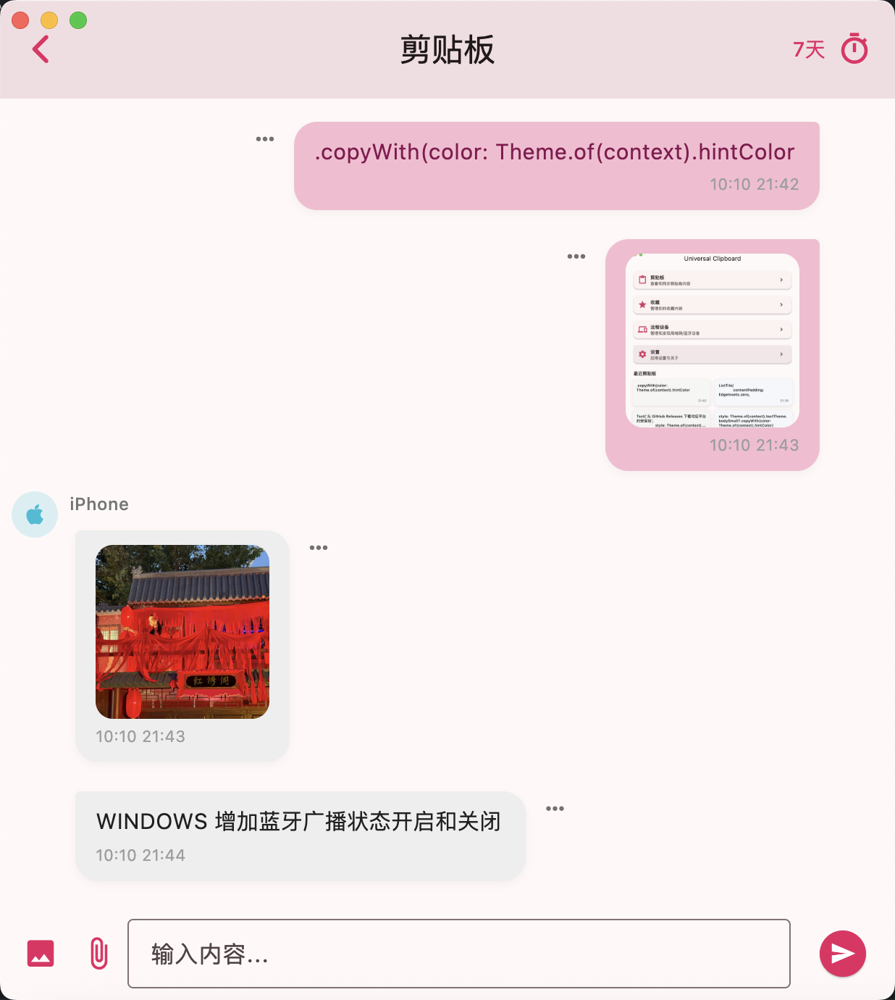
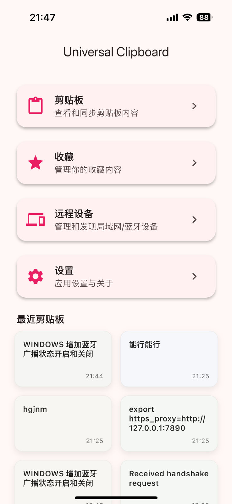

# Linkboard

[English](README.en.md)

一款跨设备粘贴板同步历史管理工具，支持局域网、蓝牙和 WebRTC 直连传输，同步文本/图片等内容。开箱即用、无云端依赖，数据仅在你的设备之间本地传输与保存。

## 功能特性
- 局域网 (TCP) + 蓝牙 (BLE) + WebRTC 设备间传输
- 当在同一局域网时使用 TCP，无法直连时回落到其他模式
- 跨平台支持：Android、iOS、Windows、macOS
- 文本与图片同步（图片按 PNG/JPEG 自动识别）
- 历史记录管理，支持保留天数配置与一键清理过期记录
- APP 键盘扩展：无需切出当前 App，可直接从历史粘贴
- 本地优先：不采集任何数据；支持可选、默认关闭的 WebDAV 同步

## 下载地址

- Windows 版：[下载桌面端](https://github.com/wanghongenpin/linkboard/releases/latest/download/linkboard-windows-setup.exe)
- macOS 版：[App Store](https://apps.apple.com/app/linkboard-cross-device-p2p/id6753873760)
- Android 版：[下载移动端](https://github.com/wanghongenpin/linkboard/releases/latest/download/linkboard-android.apk)
- iOS 版：[App Store](https://apps.apple.com/app/linkboard-cross-device-p2p/id6753873760)

> 如有新版本或其他平台支持，请关注项目主页或后续更新。

## 数据与隐私

WebDAV 同步可选且默认关闭，仅连接你配置的 HTTPS 服务器。启用后，服务器提供方可以读取同步数据，暂不提供端到端加密；同步在前台运行或手动触发。详见 [PRIVACY.md](PRIVACY.md)。

## 软件截图

  
